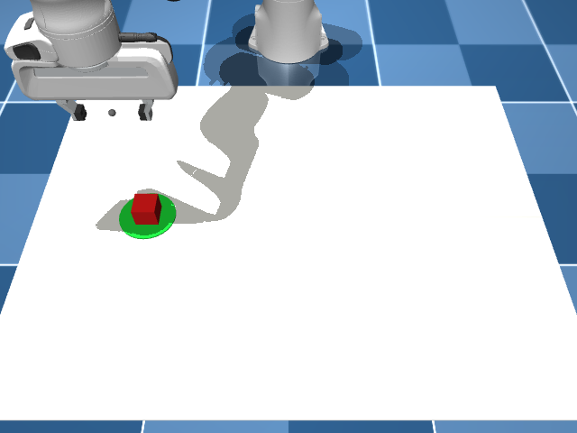

https://github.com/user-attachments/assets/d2a0497a-c2aa-4c14-a1d8-e2a6afd57b32

# Self-Doubting Robot

A simulated Franka Panda arm that checks its own work. After each pick-and-place attempt, a local 3B vision-language model (Qwen2.5-VL 3B, run through Ollama) looks at a camera frame and judges whether the cube ended up completely inside the green target circle. If it says no, the robot re-observes the cube and retries (up to 3 tries). Everything runs offline on a laptop (RTX 5060, 8 GB).

By Goushik

[Watch the demo video](demo.mp4)

## Results

150 episodes (3 seeds x 50), 1.5 cm simulated perception error on the cube position. Success is measured against the simulator's ground truth, never against the VLM.

| Setup | Success (95% CI) |
|---|---|
| No self-correction | 63.3% (55-71) |
| Self-correction, VLM judge | 88.7% (83-93) |
| Self-correction, perfect judge (ceiling) | 90.0% (84-94) |

- Lift from the VLM judge: +25.3 points (bootstrap 95% CI +18.7 to +32.0). It recovered 38 episodes and broke none.
- The judge was right on 230 of 234 verdicts (about 98%). It missed 3 of 100 failed attempts and raised 1 false alarm in 134 successes.
- The VLM and the perfect judge are statistically indistinguishable at this sample size.
- The perfect-judge numbers reproduced exactly on two different machines (same seeds).

## What went wrong along the way

- **The first VLM did not work.** gemma4 through Ollama did not receive images correctly on this setup (it described a made-up pattern, then said it saw no image). Switching to qwen2.5vl:3b fixed it.
- **My success label was ambiguous.** I first asked "is the cube on the circle?" but counted success only within 4 cm of the centre, while the disc has a 5 cm radius. Most disagreements were near-misses at the disc edge. I changed the question to "completely inside" and the label to "centre within 3 cm".
- **Camera perspective caused a false alarm.** From the oblique camera, a correctly placed tall cube can look like it hangs over the circle's edge. After the prompt change this happened once in 134 successes.

## Open problem: the slippery cube

At friction 0.2 or lower, the grasp never lifts the cube, so retrying the same grasp stays at 0% success. Slowing down or squeezing longer did not help. Pushing the cube instead works with exact positions (17 of 20) but collapses to 6 of 20 under the same 1.5 cm perception error, so a simple "grasp, grasp, push" ladder rescued only about 12% of slippery episodes. A robust fallback strategy is not solved here.

## Limitations

- Simulation only: one scene, one cube, one fixed camera, clean rendering.
- The judge has not been tested with clutter, lighting changes or other camera angles.
- Perception error is synthetic Gaussian noise added to the cube position.
- 3 seeds x 50 episodes: confidence intervals are about 6-8 points wide.

## Reproduce

    git clone --depth 1 --filter=blob:none --sparse https://github.com/google-deepmind/mujoco_menagerie.git ~/mujoco_menagerie
    (cd ~/mujoco_menagerie && git sparse-checkout set franka_emika_panda)
    pip install -r requirements.txt
    ollama pull qwen2.5vl:3b
    python evaluate.py oracle     # perfect judge, about 1 minute, no Ollama needed
    python evaluate.py vlm        # real VLM judge, about 15-20 minutes, needs Ollama running

Set the address in `vlm_judge.py` if Ollama is not at 127.0.0.1:11434 (WSL2 needs mirrored networking).

- `pickplace.py`: MuJoCo scene, IK controller, scripted pick-and-place, ground-truth success check
- `vlm_judge.py`: asks the VLM a yes/no question about a camera frame
- `vlm_retry.py`: the retry loop
- `evaluate.py`: multi-seed evaluation with confidence intervals
- `eval_oracle.json`, `eval_vlm.json`, `eval_vlm.log`: raw results

